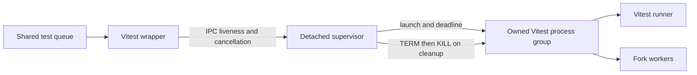

# Agentic Harness Strategy

This document defines the default human+agent development harness for Vectura Studio and provides a reusable template for future projects.

## 1) Purpose and Outcomes

Goals:
- Make development interactions faster, clearer, and more reliable.
- Reduce rework by requiring explicit scope, acceptance criteria, and evidence.
- Keep process guidance synchronized across markdown control documents.
- Provide a portable harness that can be copied to future repositories.

Expected outcomes:
- Contributors can find workflow rules in under two minutes.
- PRs changing workflow/tooling policies include harness updates or an explicit rationale.
- Test and documentation expectations are consistent across docs and PR review.

## 2) Source-of-Truth Hierarchy

Use this precedence order when instructions conflict:
1. System/developer/tool runtime constraints.
2. Repository-level `AGENTS.md`.
3. Task-specific user instructions.
4. Domain docs (`README.md`, `docs/testing.md`, feature docs, requirement docs).

Conflict rule:
- Follow the highest-precedence instruction.
- If lower-precedence docs become stale, update them in the same PR as part of doc synchronization.
- If conflicts cannot be resolved safely, stop and request clarification.

## 3) Task Lifecycle Protocol

### Intake format
Every request should define:
- Goal and desired outcome.
- Scope boundaries (in/out).
- Acceptance criteria.
- Validation expectations (commands/manual checks).
- Delivery constraints (deadline, compatibility, rollback limits).

### Discovery-first workflow
1. Inspect current implementation and docs before proposing changes.
2. Confirm assumptions with direct evidence from files/tests/config.
3. Only ask questions that cannot be answered from repository context.

### Plan completeness criteria
A plan is implementation-ready only when it covers:
- Approach and affected files.
- Interfaces/contracts that change.
- Failure modes and edge cases.
- Test matrix and acceptance checks.
- Documentation updates required by the doc-sync matrix.

### Implementation evidence requirements
For each change, record:
- Commands executed.
- Pass/fail status.
- Any skipped checks and why.
- Residual risks or follow-up items.

### Closeout report template
Use this output structure in PR descriptions or handoff notes:

```md
## Summary
- What changed and why.

## Validation
- Command: <command> -> PASS/FAIL
- Manual check: <scenario> -> PASS/FAIL

## Documentation
- Updated: <paths>
- Not updated: <paths + rationale>

## Risks / Follow-ups
- <item>
```

## 4) Execution Standards

- Break work into small, bounded tasks with clear completion criteria.
- Define acceptance criteria before implementation.
- Prefer deterministic checks over ad-hoc validation.
- Keep commits/PRs reviewable and evidence-backed.
- Default to non-destructive operations; escalate destructive actions explicitly.

Artifact reporting standard:
- `commands_run`: exact commands used for verification.
- `results`: concise pass/fail outcome.
- `residual_risk`: explicit note of any unverified surfaces.

## 5) Testing Matrix (Minimum Required Checks)

CI runner images: Playwright-browser jobs are pinned to `ubuntu-24.04` (see `docs/testing.md` → CI: Pull Requests); changing a runner image is a workflow change and must re-prove the WebKit touch leg.

| Change class | Minimum checks | Additional checks when applicable |
| --- | --- | --- |
| Docs-only (no behavior change) | Link/path sanity review | None |
| Core logic / algorithm behavior | `npm run test:unit` | `npm run test:integration`, `npm run test:visual` |
| Export/serialization/security surfaces | `npm run test:unit` + `npm run test:integration` | `npm run test:e2e` |
| UI interaction behavior | `npm run test:integration` | `npm run test:e2e`, targeted manual UX pass |
| Rendering output or baselines | `npm run test:visual` | `npm run test:perf` for heavy-path changes |
| Full gate | CI `ci-ok` (required check) | Local `npm run test:ci` is optional |

Touch changes (TUX-057/061): UI changes for touch run `npm run test:e2e:touch` (7 Chromium `touch-*` and 4 WebKit `webkit-*` projects). Set `PW_PORT` per worktree. Use `tests/e2e/helpers/touch.js` for every finger gesture, and guard engine-specific assertions with `engineSupports` (`trustedMultiTouch`, `maxTouchPoints`, `nativeDefaultActions`) instead of `test.skip`. The project list, capabilities, approved deviations and the list of what WebKit simulation does not prove are in `docs/testing.md`. Real-device items stay in the section 4.2 device run. CI runs only a touch smoke on PRs (`e2e-smoke`, two projects) and the full touch roster nightly (`touch-e2e-nightly`), so a local run of the affected touch specs is the PR-time evidence for touch changes.

Reference:
- Test policies and command details live in `docs/testing.md`.
- The harness currently assumes Node 20.19+ and a matched Vitest 4 / V8 coverage-provider pair;
  version-specific pool configuration is documented in `docs/testing.md`.
- Local Playwright compatibility notes also live in `docs/testing.md`; local browser fallbacks must stay documented there and in `AGENTS.md` whenever the e2e runtime contract changes.
- **Shared local test queue.** Local test runs go through `scripts/test-queue.js`, one
  machine-wide lock shared by every worktree and agent session. Agents run tests only through
  the `npm run test:*` entrypoints (single files: `npm run test:vitest -- run <file>`,
  `npm run test:playwright -- <spec>`), never `npx vitest` or `npx playwright test` directly.
  Any new heavy test script in `package.json` must route through the queue; an aggregate script
  wraps its whole chain once. CI bypasses the queue (`CI` set). Contract: `docs/testing.md` →
  "Shared Local Test Queue".

### Test policy (owner decisions, October 2026)

These rules replace the earlier acceleration and phase-two contracts (now in `docs/archive/`).
The adjudicated review is `docs/archive/2026-10-test-ci-review.md`.

- **D-1 Gating.** Every test runs pre-merge on every PR that can affect it (path-routed, shared
  dependencies included). Every test runs on `main` nightly, with an auto-issue on red. A path
  filter must be sound: `scripts/audit-paths.js` covers every file the audits load, and the audit
  loader throws on a script outside the filter. An unknown diff runs everything.
- **D-2 Coverage.** The coverage ratchet (statements 74 %, branches 62 %, functions 74 %,
  lines 76 %) runs on every main push and on a non-deduplicated nightly, not on PRs. PRs keep
  `test-profile --strict` on the merged uninstrumented results.
- **D-3 Local rule.** `ci-ok` is the full gate once branch protection requires it. Locally, run
  `npm run test:feedback` plus the touched test files. `npm run test:ci` stays available and is no
  longer required before a commit. Red–Green–Refactor still applies to every behavior change.
- **D-4 Fix tests.** A fix commits a test of the *current* contract. The RED proof goes in the commit
  message or the PR. Do not commit a reconstruction of the pre-fix tree. Exact output is pinned in
  regenerable golden values (`tests/helpers/golden-values.js`), never read from git history.
  `tests/unit/no-git-history-in-tests.test.js` enforces this.
- **D-5 Scene3D budget.** Scene3D tests take at most 50 % of coverage file-seconds. This is a
  reported target, not a gate. The share is about 55 % after the October 2026 cuts.
- **D-6 Browsers.** No desktop WebKit project for now. WebKit runs in the touch projects.
- **D-7 Touch.** The full touch roster runs nightly. The 2-project touch smoke runs on every PR.
- **D-8 Docs.** `docs/testing.md` is the one operational test guide. Rollout, review and punchlist
  documents go to `docs/archive/`.
- **D-9 Shards.** 8 uninstrumented Vitest shards on PRs, 12 instrumented coverage shards on main
  and nightly. Re-plan from blob weights when the roster changes.
- **Trims.** Every removed assertion class needs a mutation proof that a remaining test still
  fails. Keep one witness per failure mechanism. Never lower a threshold, add a skip or raise a
  timeout to save time.
- **Known defects.** A canary that finds a product defect records it in an inverted known-defect
  entry (the fix fails the test until the entry goes), in `plans.md` and in
  `docs/pre-release-hardening-log.md`.

Timing claims need two hosted runs, measured from workflow creation to the last required check.
Report runner time separately. Budgets, trim rules and history: [test-performance-lessons.md](test-performance-lessons.md).
For GitHub Actions shell commands with backslash-newline continuations, use a literal YAML block
(`run: |`); a folded plain scalar turns the newline into a space and can corrupt CLI arguments.

### Vitest lifecycle ownership

All repository Vitest entrypoints use `scripts/run-vitest.js`, which launches a
separate supervisor and owned process group. Cleanup runs independently of model
availability, before retries and after completion, cancellation, wrapper death, or
the configurable per-attempt deadline (30 minutes locally / three hours in CI). Deadline/cancellation/cleanup errors
remain failures. Use `npm run test:runner` plus the wrapper-policy unit tests when
changing this lifecycle. These checks are also part of the unit entrypoint.
POSIX/WSL requirements and protection limits are documented in `docs/testing.md`.
The shared queue owns the outer run; the Vitest supervisor handles each inner attempt.
Waiting for the queue does not start the Vitest deadline. Playwright retains queue ownership.



## 6) Documentation Synchronization Matrix

| Change category | Required documentation updates |
| --- | --- |
| Workflow/tooling/test policy changes | `docs/agentic-harness-strategy.md` (policy) and `docs/testing.md` (operation); update the short summaries in `AGENTS.md`/`CLAUDE.md`/`README.md` only when they change; `CHANGELOG.md` |
| PR governance/process changes | `.github/pull_request_template.md` plus harness doc if policy changed |
| UI behavior / shortcuts / help changes | `README.md`, in-app help guide, in-app shortcut list, and `index.html` version increment |
| Feature capability changes | `README.md` relevant sections, `plans.md`, `CHANGELOG.md`, and any feature-specific docs |
| **Skin authoring / theme work** | `docs/skin-authoring.md`, `src/ui/skin/_template.css` (if token contract changes), `src/config/defaults.js` (manifest registry), `README.md` skin section, `CHANGELOG.md`, and `tests/unit/skin/` for new skin compile-gate or contract tests. Reduced-motion + a11y compliance tests must continue to pass. |
| Deferred release-hardening ideas | Add/update entry in `docs/pre-release-hardening-log.md` |
| Any repository change | Assess whether `plans.md`, `CHANGELOG.md`, README release notes, and the canonical package version need updates; when the version changes run `npm run version:sync` |

No-silent-drift rule:
- If a workflow-affecting change lands without corresponding doc updates, treat it as incomplete.

## 7) Prompting and Agent Collaboration Patterns (Codex Adapter)

Preferred request format:

```md
Goal:
Scope:
Acceptance Criteria:
Validation:
Constraints:
```

Collaboration defaults:
- Ask for a plan when scope is ambiguous or large.
- Use discovery before coding.
- Keep clarification questions limited to high-impact unknowns.
- Return evidence-first summaries: changes, tests, risks.
- Respect safety boundaries for destructive operations and restricted network/tool actions.

## 8) Legacy Doc Status Taxonomy

Status labels:
- `authoritative`: current source of truth for active behavior/policy.
- `operational`: active runbook/process reference.
- `backlog`: idea bank; not strict implementation contract.
- `archive-candidate`: useful history, but should not drive active decisions without reconfirmation.

Current classification:

| Document | Status | Owner expectation | Review cadence |
| --- | --- | --- | --- |
| `README.md` | `authoritative` | Feature owners + PR authors | Every feature/change PR |
| `CHANGELOG.md` | `authoritative` | Release owners + PR authors | Every user-visible or workflow-significant PR |
| `docs/testing.md` | `operational` | Test/tooling maintainers + PR authors | Any test/CI workflow change |
| `docs/test-performance-lessons.md` | `operational` | Test/tooling maintainers + PR authors | Any test trim, split or shard change |
| `docs/archive/*` | `archive-candidate` | None | None |
| `docs/github-governance.md` | `operational` | Repo administrators + PR authors | Any repo-governance change |
| `docs/noise-rack-architecture.md` | `authoritative` | Architecture owners + PR authors | Any universal-noise architecture change |
| `plans.md` | `operational` | Product/feature planning owner + PR authors | Every feature/change PR |
| `docs/pre-release-hardening-log.md` | `operational` | Release/hardening owner + PR authors | On each deferred hardening item |

## 9) Future Project Bootstrap (Reusable Starter)

For new repos, copy this harness with these minimum hooks:
1. Add `docs/agentic-harness-strategy.md`.
2. Add/update `AGENTS.md` with mandatory harness-maintenance policy.
3. Add `.github/pull_request_template.md` with harness review checkbox.
4. Define a testing matrix tied to available scripts/CI.
5. Define a documentation synchronization matrix for that repo.
6. Establish doc status taxonomy and initial classifications.
7. Add README pointer to workflow docs for discoverability.

## 10) Governance

Update triggers (must update this document when changed):
- Task intake expectations.
- Planning/execution/reporting standards.
- Test policy thresholds or required commands.
- Documentation synchronization rules.
- Agent safety/approval boundaries.
- PR checklist enforcement rules.

PR coupling:
- PR template requires explicit harness review/update acknowledgment.

No silent drift:
- Workflow changes without harness/doc sync should be flagged in review and treated as incomplete.

## 11) Public Process Contracts

This harness introduces four explicit process contracts:
1. Harness Source-of-Truth Contract: `docs/agentic-harness-strategy.md` defines default agent workflow policy.
2. Documentation Contract: change-to-doc mapping matrix defines mandatory doc updates.
3. Governance Contract: PR checklist must assert harness review/update status.
4. Status Taxonomy Contract: shared labels reduce ambiguity across markdown docs.

## 12) Rollout Validation Scenario (Checklist Simulation)

Sample PR scenario:
- Change: update CI test command and Playwright policy.
- Expected required docs:
  - `docs/agentic-harness-strategy.md` (workflow/test policy impact)
  - `AGENTS.md` or `docs/testing.md` where command expectations changed
  - `.github/pull_request_template.md` only if checklist policy changed

Checklist pass condition:
- PR explicitly confirms harness doc review.
- If harness doc unchanged, PR provides rationale in checklist.
