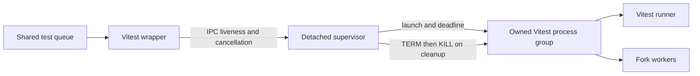

# Agentic Harness Strategy

This document defines the default human+agent development harness for Vectura Studio and provides a reusable template for future projects.

## 1) Purpose and Outcomes

Goals:
- Make development interactions faster, clearer, and more reliable.
- Reduce rework by requiring explicit scope, acceptance criteria, and evidence.
- Keep process guidance synchronized across markdown control documents.
- Provide a portable harness that can be copied to future repositories.

Expected outcomes:
- Contributors can find workflow rules in under two minutes.
- PRs changing workflow/tooling policies include harness updates or an explicit rationale.
- Test and documentation expectations are consistent across docs and PR review.

## 2) Source-of-Truth Hierarchy

Use this precedence order when instructions conflict:
1. System/developer/tool runtime constraints.
2. Repository-level `AGENTS.md`.
3. Task-specific user instructions.
4. Domain docs (`README.md`, `docs/testing.md`, feature docs, requirement docs).

Conflict rule:
- Follow the highest-precedence instruction.
- If lower-precedence docs become stale, update them in the same PR as part of doc synchronization.
- If conflicts cannot be resolved safely, stop and request clarification.

## 3) Task Lifecycle Protocol

### Intake format
Every request should define:
- Goal and desired outcome.
- Scope boundaries (in/out).
- Acceptance criteria.
- Validation expectations (commands/manual checks).
- Delivery constraints (deadline, compatibility, rollback limits).

### Discovery-first workflow
1. Inspect current implementation and docs before proposing changes.
2. Confirm assumptions with direct evidence from files/tests/config.
3. Only ask questions that cannot be answered from repository context.

### Plan completeness criteria
A plan is implementation-ready only when it covers:
- Approach and affected files.
- Interfaces/contracts that change.
- Failure modes and edge cases.
- Test matrix and acceptance checks.
- Documentation updates required by the doc-sync matrix.

### Implementation evidence requirements
For each change, record:
- Commands executed.
- Pass/fail status.
- Any skipped checks and why.
- Residual risks or follow-up items.

### Closeout report template
Use this output structure in PR descriptions or handoff notes:

```md
## Summary
- What changed and why.

## Validation
- Command: <command> -> PASS/FAIL
- Manual check: <scenario> -> PASS/FAIL

## Documentation
- Updated: <paths>
- Not updated: <paths + rationale>

## Risks / Follow-ups
- <item>
```

## 4) Execution Standards

- Break work into small, bounded tasks with clear completion criteria.
- Define acceptance criteria before implementation.
- Prefer deterministic checks over ad-hoc validation.
- Keep commits/PRs reviewable and evidence-backed.
- Default to non-destructive operations; escalate destructive actions explicitly.

Artifact reporting standard:
- `commands_run`: exact commands used for verification.
- `results`: concise pass/fail outcome.
- `residual_risk`: explicit note of any unverified surfaces.

## 5) Testing Matrix (Minimum Required Checks)

| Change class | Minimum checks | Additional checks when applicable |
| --- | --- | --- |
| Docs-only (no behavior change) | Link/path sanity review | None |
| Core logic / algorithm behavior | `npm run test:unit` | `npm run test:integration`, `npm run test:visual` |
| Export/serialization/security surfaces | `npm run test:unit` + `npm run test:integration` | `npm run test:e2e` |
| UI interaction behavior | `npm run test:integration` | `npm run test:e2e`, targeted manual UX pass |
| Rendering output or baselines | `npm run test:visual` | `npm run test:perf` for heavy-path changes |
| CI-gating confidence pass | `npm run test:ci` | Add visual/perf runs before release-critical merges |

Reference:
- Test policies and command details live in `docs/testing.md`.
- The harness currently assumes Node 20.19+ and a matched Vitest 4 / V8 coverage-provider pair;
  version-specific pool configuration is documented in `docs/testing.md`.
- Local Playwright compatibility notes also live in `docs/testing.md`; local browser fallbacks must stay documented there and in `AGENTS.md` whenever the e2e runtime contract changes.
- **Shared local test queue.** Local test runs go through `scripts/test-queue.js`, one
  machine-wide lock shared by every worktree and agent session. Agents run tests only through
  the `npm run test:*` entrypoints (single files: `npm run test:vitest -- run <file>`,
  `npm run test:playwright -- <spec>`), never `npx vitest` or `npx playwright test` directly.
  Any new heavy test script in `package.json` must route through the queue; an aggregate script
  wraps its whole chain once. CI bypasses the queue (`CI` set). Contract: `docs/testing.md` →
  "Shared Local Test Queue".

### Accelerated feedback and promotion

Bounded `test:feedback` supplies local iteration and the pre-push gate; it does not certify
full-suite coverage. Explicit path routing must fail broadly for unknown/shared/harness changes.
Fresh VM/DOM profiles isolate mutable state, while only immutable compiled scripts may be cached.
Local ordinary runs default to two workers, full local coverage to one, and CI retains two.
Exhaustive rendering proofs remain in `tests/audit/`, and full coverage scope/thresholds remain
unchanged. Existing GitHub gates stay required during shadow evaluation. Promotion needs a
validated evidence ledger, exact-revision audit evidence and operational audit-failure ownership.
Local execution, queue wait, hosted queue/setup and total runner-minutes must be reported separately.
See `test-suite-acceleration.md` for targets and `test-suite-acceleration-punchlist.md` for findings.

### Full PR correctness ownership (phase two)

Full-scope coverage owns non-E2E Vitest correctness, including unit, integration, visual,
performance and exhaustive audit files. Historical unit/integration/visual required checks
may be compatibility aliases only when they depend on a successful authoritative coverage
job; aliases are never independent test evidence. Lifecycle checks, uninstrumented
performance and the complete configured browser roster retain explicit owners.
`test:ci` mirrors these guarantees locally within one shared queue slot. `test:fast` is
a bounded-feedback alias and cannot certify the full suite. Coverage thresholds remain
unchanged. This is execution deduplication, not selective test-routing promotion.

PR #97 enabled full-Vitest sharding after hosted validation and independent review: a plan/guard binds the exact source SHA
and timestamp to two disjoint duration-weighted partitions on pull requests and pushes to
main, and a canonical required coverage job always runs for those events. It fails closed
on a failed plan, guard, or shard; verifies same-run/same-SHA report provenance; checks
each shard roster, merges V8 data, then strictly checks every file and the 57-skip baseline
before acceptance; it applies the canonical statements 74%, branches
62%, functions 74%, and lines 76% ratchets. Existing bounded feedback, probe, browser,
performance, and lane-gate checks remain in place. The scheduled audit runs separately,
followed by the uninstrumented visual and performance suites. The first complete main graph
passed on run 38601029835: coverage 52m59s, all required checks 53m32s. Compared with the
101m23s unsharded coverage-job baseline, its coverage subtree used 92m59s allocated job
time. This equivalent-application, cross-SHA observation is not a controlled benchmark.

Render-test sampling decisions live in `docs/render-test-reductions.md`. Retiring an
internal diagnostic oracle or named parameter sample requires recording the accepted loss;
a unique assertion is not automatically a durable product contract. Preserve real-output
regression witnesses, boundary cases, state isolation and raw/composed seam distinctions.
Validate the combined remaining suite, since individually proposed deletions can depend
on one another. Keep inventory strict and thresholds unchanged; do not convert retirement
into skipped tests or fabricate speedup estimates from render counts.

Local `test:ci`, queue behavior, worker defaults, and the 30-minute per-attempt deadline
are unchanged. A separately measured two-worker full-coverage route took 39m40s, so that
measurement does not establish that a plain local `npm run test:ci` invocation finishes.
Historical schema 2/3 roster data remains readable but cannot qualify the new schema 4
topology; promotion requires 20 genuine schema 4 observations. The local fast/pre-push lane
remains unchanged.
The custom duration sequencer is ESM so Vite can load `vitest/node` without rewriting a CommonJS import to an invalid file-URL `require`; the bounded probe exercises the real config path. Hosted feedback runs this small probe afterward as a separate step, outside feedback-lane timing metrics and the full-coverage critical path; the local fast/pre-push lane remains unchanged.
For GitHub Actions shell commands with backslash-newline continuations, use a literal YAML block (`run: |`); a folded plain scalar turns the newline into a space and can corrupt CLI arguments.

Changes to topology must synchronize the aggregate gate, versioned evidence roster and
branch-protection compatibility. Engine/pool or sharding candidates require measured
compatibility, source attribution and cleanup checks before promotion. Missing shards or
coverage reports fail closed; never average per-shard coverage percentages. Promotion
also requires strict current-topology evidence, review, at least 30% lower whole-chain
latency and no more than about 15% extra allocated runner time. Record each measured comparison and its scope. See
`test-suite-phase2.md` for baseline, implementation evidence and remaining targets.

### Vitest lifecycle ownership

All repository Vitest entrypoints use `scripts/run-vitest.js`, which launches a
separate supervisor and owned process group. Cleanup runs independently of model
availability, before retries and after completion, cancellation, wrapper death, or
the configurable per-attempt deadline (30 minutes locally / three hours in CI). Deadline/cancellation/cleanup errors
remain failures. Use `npm run test:runner` plus the wrapper-policy unit tests when
changing this lifecycle. These checks are also part of the unit entrypoint.
POSIX/WSL requirements and protection limits are documented in `docs/testing.md`.
The shared queue owns the outer run; the Vitest supervisor handles each inner attempt.
Waiting for the queue does not start the Vitest deadline. Playwright retains queue ownership.



## 6) Documentation Synchronization Matrix

| Change category | Required documentation updates |
| --- | --- |
| Workflow/tooling/test policy changes | `docs/agentic-harness-strategy.md`, `AGENTS.md`, `plans.md`, `CHANGELOG.md`, and any impacted sections of `README.md`/`docs/testing.md` |
| PR governance/process changes | `.github/pull_request_template.md` plus harness doc if policy changed |
| UI behavior / shortcuts / help changes | `README.md`, in-app help guide, in-app shortcut list, and `index.html` version increment |
| Feature capability changes | `README.md` relevant sections, `plans.md`, `CHANGELOG.md`, and any feature-specific docs |
| **Skin authoring / theme work** | `docs/skin-authoring.md`, `src/ui/skin/_template.css` (if token contract changes), `src/config/defaults.js` (manifest registry), `README.md` skin section, `CHANGELOG.md`, and `tests/unit/skin/` for new skin compile-gate or contract tests. Reduced-motion + a11y compliance tests must continue to pass. |
| Deferred release-hardening ideas | Add/update entry in `docs/pre-release-hardening-log.md` |
| Any repository change | Assess whether `plans.md`, `CHANGELOG.md`, README release notes, and the canonical package version need updates; when the version changes run `npm run version:sync` |

No-silent-drift rule:
- If a workflow-affecting change lands without corresponding doc updates, treat it as incomplete.

## 7) Prompting and Agent Collaboration Patterns (Codex Adapter)

Preferred request format:

```md
Goal:
Scope:
Acceptance Criteria:
Validation:
Constraints:
```

Collaboration defaults:
- Ask for a plan when scope is ambiguous or large.
- Use discovery before coding.
- Keep clarification questions limited to high-impact unknowns.
- Return evidence-first summaries: changes, tests, risks.
- Respect safety boundaries for destructive operations and restricted network/tool actions.

## 8) Legacy Doc Status Taxonomy

Status labels:
- `authoritative`: current source of truth for active behavior/policy.
- `operational`: active runbook/process reference.
- `backlog`: idea bank; not strict implementation contract.
- `archive-candidate`: useful history, but should not drive active decisions without reconfirmation.

Current classification:

| Document | Status | Owner expectation | Review cadence |
| --- | --- | --- | --- |
| `README.md` | `authoritative` | Feature owners + PR authors | Every feature/change PR |
| `CHANGELOG.md` | `authoritative` | Release owners + PR authors | Every user-visible or workflow-significant PR |
| `docs/testing.md` | `operational` | Test/tooling maintainers + PR authors | Any test/CI workflow change |
| `docs/github-governance.md` | `operational` | Repo administrators + PR authors | Any repo-governance change |
| `docs/noise-rack-architecture.md` | `authoritative` | Architecture owners + PR authors | Any universal-noise architecture change |
| `plans.md` | `operational` | Product/feature planning owner + PR authors | Every feature/change PR |
| `docs/pre-release-hardening-log.md` | `operational` | Release/hardening owner + PR authors | On each deferred hardening item |

## 9) Future Project Bootstrap (Reusable Starter)

For new repos, copy this harness with these minimum hooks:
1. Add `docs/agentic-harness-strategy.md`.
2. Add/update `AGENTS.md` with mandatory harness-maintenance policy.
3. Add `.github/pull_request_template.md` with harness review checkbox.
4. Define a testing matrix tied to available scripts/CI.
5. Define a documentation synchronization matrix for that repo.
6. Establish doc status taxonomy and initial classifications.
7. Add README pointer to workflow docs for discoverability.

## 10) Governance

Update triggers (must update this document when changed):
- Task intake expectations.
- Planning/execution/reporting standards.
- Test policy thresholds or required commands.
- Documentation synchronization rules.
- Agent safety/approval boundaries.
- PR checklist enforcement rules.

PR coupling:
- PR template requires explicit harness review/update acknowledgment.

No silent drift:
- Workflow changes without harness/doc sync should be flagged in review and treated as incomplete.

## 11) Public Process Contracts

This harness introduces four explicit process contracts:
1. Harness Source-of-Truth Contract: `docs/agentic-harness-strategy.md` defines default agent workflow policy.
2. Documentation Contract: change-to-doc mapping matrix defines mandatory doc updates.
3. Governance Contract: PR checklist must assert harness review/update status.
4. Status Taxonomy Contract: shared labels reduce ambiguity across markdown docs.

## 12) Rollout Validation Scenario (Checklist Simulation)

Sample PR scenario:
- Change: update CI test command and Playwright policy.
- Expected required docs:
  - `docs/agentic-harness-strategy.md` (workflow/test policy impact)
  - `AGENTS.md` or `docs/testing.md` where command expectations changed
  - `.github/pull_request_template.md` only if checklist policy changed

Checklist pass condition:
- PR explicitly confirms harness doc review.
- If harness doc unchanged, PR provides rationale in checklist.
