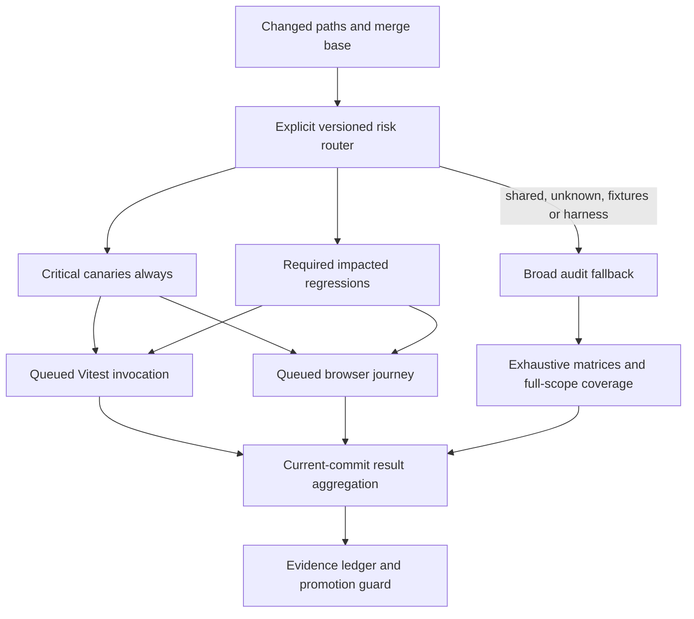

# Test-suite acceleration

This document describes the implementation contract for faster local feedback and GitHub
verification. The canonical policy remains `docs/agentic-harness-strategy.md`, with operational
commands in `docs/testing.md`. Work and adjudicated findings are tracked through `plans.md`
and `docs/test-suite-acceleration-punchlist.md`.

## Outcomes and evidence

The initial assessment of three successful earlier CI revisions found unit steps taking
41–57 minutes and coverage steps taking 58–109 minutes. A 30-second observation of another
worktree saw up to 4.72 GiB summed process RSS. These are historical/observational baselines,
not current-revision performance claims; shared memory can be counted more than once in RSS.

The targets are warm local feedback under60s, ordinary PR readiness under5min, and broader
high-risk PR checks under10min where regression protection can be preserved. PR readiness
means the current commit has every required check green, including CodeQL/dependency review
where required. Count hosted queue and cold setup in user waiting time; show execution from
first required job start to last required result separately. A missed budget stays visible
and never turns skipped, cancelled, timed-out or missing work into success.

## Workload architecture

Local heavy work keeps the one-machine test queue and owned-process supervisor. Concurrent
agents and worktrees may edit disjoint files; their test executions remain serialized by the
queue. Do not bypass it. Deep audit work should be independently bounded and aggregated so
sharding does not lose scenarios. CI concurrency and total runner-minutes both need limits;
more workers are not themselves an optimization.

## Focused runtimes

Pure/core and feature VM profiles load explicit IIFE dependencies into fresh namespaces.
Component DOM profiles provide only the required markup and collaborators. Full app profiles
retain real shell/script-order checks. Default legacy loading remains compatible while tests
migrate deliberately. Immutable source or compiled scripts may be cached; live windows,
App instances, timers, mutated defaults and override state must never cross runtimes.

Cache identity and invalidation cover source bytes/root, options and source overrides. The canonical coverage command explicitly exports `VECTURA_TEST_COVERAGE=1`, disabling compiled caching even when worker arguments omit coverage flags.
Missing explicit dependencies fail visibly. Preserve script evaluation order and verify
coverage attribution before using compilation caches under instrumentation. Keep DOM workers
on forks unless an alternative demonstrates stability against the recorded JSDOM/V8 crashes.

## Rendering regressions and audits

Small current-code guards protect each distinct failure mechanism. Exhaustive law/geometry
matrices, historical RED reconstruction and broad mutation experiments live in the audit
lane. They are preserved, not erased to make the routine gate green. Physically separate
expensive setup: selecting test names still executes a shared `beforeAll`.

Within a fixture, compute immutable output once for independent assertions. Determinism and
mutation-sensitivity checks must execute fresh work. Process mutant runtimes sequentially,
close each runtime reliably, and retain summaries rather than all intermediate paths/rasters.
Aggregate assertions consume computed fixture tables rather than sibling-test side effects.

Preserve seed-zero behavior, saved-document/export equivalence, file-preset/UI default origins,
masking/transforms/undo, curved/faceted rendering distinctions, ribbon width/placement/pen-scale,
import sanitization and actual browser generation/canvas/control/stats behavior. A smaller
fixture is acceptable only when it still catches its known bad implementation.

## Routing and GitHub promotion

The IIFE application loads modules through fs/vm, so import-graph-related selection is not a
complete dependency map. Every changed path must be explicitly classified or select a broad
fallback. Handle deleted/renamed files, absent merge bases, shared source, defaults, presets,
fixtures, tests, router/config and loader changes. Critical canaries always execute.

Required browser and core jobs should start concurrently. During shadow evaluation, the result aggregator expects every retained PR guarantee plus feedback for the current commit; unexpected skipped/missing/cancelled jobs fail. Phase two makes full-scope coverage the authoritative Vitest execution and preserves unit/integration/visual check names as coverage-dependent aliases, not independent evidence. Lifecycle, uninstrumented perf and the browser roster retain explicit owners.
A docs-only omission is an explicit validated routing result. Preserve required status names
or transition branch rules with the workflow rollout.

Full coverage thresholds retain their existing scope and values (statements74, lines76,
functions74, branches62). Selected-test coverage percentages are not comparable to that full
ratchet. Moving full coverage out of routine PRs deliberately increases detection latency,
so the implementation includes a shadow/promotion guard instead of claiming equivalent policy.

Promotion validates complete per-job GitHub run provenance, exact/latest revision, consistent route classes, and the terminal sequence of twenty green changes under the current versioned job topology. Historical legacy rows remain readable but do not certify the new topology. Sparse or synthetic roster summaries cannot promote policy. Twenty representative shadow changes are initial validation, not p95 certification. Include
shared/harness/fixture changes, slow3D, ordinary UI/core, docs-only and cold caches. Require
known defect sensitivity, complete routing and runner-minute evidence. Gather at least30
comparable observations per reported class before displaying an empirical p95, with sample
uncertainty stated. Future CI observations cannot be fabricated in local validation.

After promotion, broad audit failures need an operational affected-merge block and a named
maintainer, with triage within one working day. Unknown failure scope blocks broadly. Release
candidates require broad audit/coverage evidence at the exact candidate revision. Cancel only
superseded same-PR runs; preserve main/release evidence.

## Verification record

The implementation punchlist records actual commands, outcomes, adversarial findings and
adjudication. The local test runner reports command time separately from queue wait. A timeout
is a failure, and an incomplete run provides only a lower bound. Do not claim the optimized
suite, full PR or resource target achieved until its measured evidence supports that claim.

### Completed local evidence (11 October)

- Complete warm feedback:23s after queue acquisition;16 lifecycle checks,52 Vitest tests,
  and one real browser drawing/control/stats journey passed. Queue wait was684.682s and
  is excluded from the execution figure; total shell elapsed707.58s includes that wait.
- Focused regression/visual/perf selection:19 files,154 passed and13 existing skips,
  11.22s execution. This differs from the12-file baseline selection; no direct speedup
  percentage is inferred.
- Final review fixes:22 passed in1.20s, including routing, complete/stale/conflicting
  promotion evidence, cancellation, loader isolation/cache and the dispatch mutant.
- Instrumented attribution diagnostic:14 passed in430ms with real RNG source attributed
  and caching disabled. Its selected source scope does not certify the global ratchet.
- Complete browser roster:67passed,15 existing optional/project-specific skips,84.45s
  elapsed. The programmatic Shift+drag mask test now runs; its pre-existing disabled
  real-mouse counterpart remains disabled.
- Full preserved audit experiment:incomplete; deadline failure124 after300s with one worker.
  Ten process-tree samples reached1,173,696KiB summedRSS; shared pages may be counted more
  than once. No full-audit pass or before/after memory savings is claimed.

One local feedback sample meets the execution target. Hosted PR targets, full audit/coverage
certification, and empirical p95 evidence remain outstanding.
