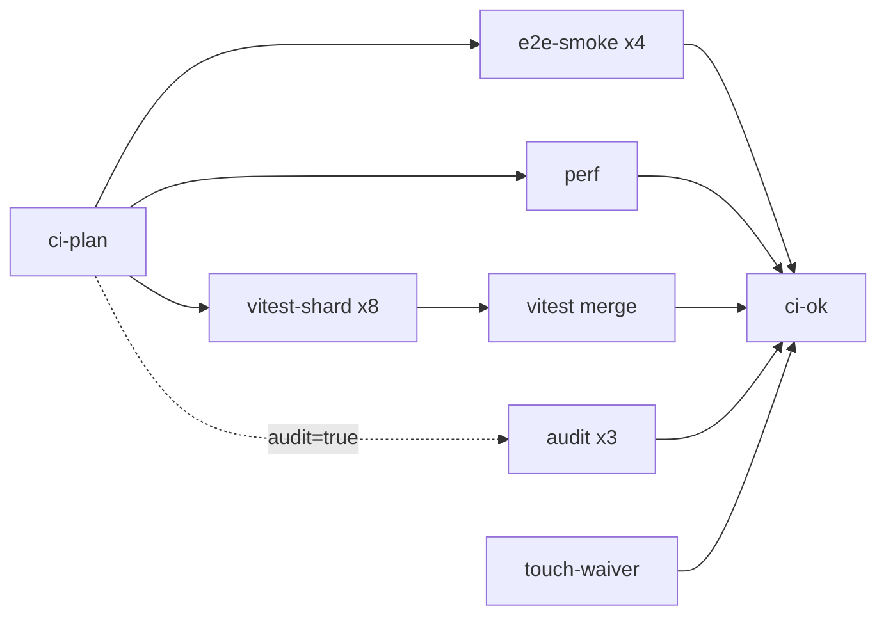

# Testing Guide

This is the one operational guide for tests and CI. It covers commands, the CI job graph,
baselines, corpora, shard weights and the local test queue.

- Test policy (what must run, and when) lives in `docs/agentic-harness-strategy.md` section 5.
- Rules for adding, trimming and timing tests live in the lessons ledger,
  [test-performance-lessons.md](test-performance-lessons.md).
- Earlier rollout, review and punchlist documents are in `docs/archive/`. They are history only.

## Toolchain

- Node 20.19 or newer runs the toolchain, but use Node 24: `.nvmrc` pins 24.22.1 and every CI job
  runs Node 24. Node 20 is end of life and has no fix for the Brotli decoder RCE (CVE-2026-111497).
- Golden values are exact on Node 24 only, because V8 versions round `Math` results differently.
- Every third-party action is pinned to a full commit SHA with its release tag in a trailing
  comment. Dependabot's `github-actions` updates keep both current.
  See [Goldens and baselines](#goldens-and-baselines).
- Vitest 4 runs unit, integration, visual, perf and audit tests (`vitest.config.mjs`). Keep `vitest`
  and `@vitest/coverage-v8` on the same version. Workers use the `forks` pool with at most two
  workers locally and in CI (`VECTURA_VITEST_MAX_WORKERS`). Full local coverage uses one worker.
- Playwright runs the browser tests (`playwright.config.js`). When the managed Chromium is missing
  locally, the config falls back to an installed Chrome and turns off failure videos.
- `tests/helpers/load-vectura-runtime.js` loads the browser IIFE modules into jsdom. Use the `core`
  or `feature` profile for pure modules, `component` for small DOM fixtures, and the legacy or full
  profile for app-shell checks. Each runtime is fresh and must be closed.
- There is no desktop WebKit project (owner decision D-6). WebKit runs only in the touch projects.

## Local Commands

| Command | Purpose |
|---|---|
| `npm run test:feedback` | Bounded local feedback: lifecycle checks, the critical roster (`tests/helpers/feedback-roster.json`) and one real browser journey, with a 60 s execution deadline. The `pre-push` hook runs it. |
| `npm run test:runner` | Process-lifecycle checks (`tests/process`, Node's test runner). No queue lock. |
| `npm run test:unit` | Lifecycle checks, then `tests/unit`. |
| `npm run test:integration` | `tests/integration`, including the preset and legacy-file corpora. |
| `npm run test:visual` | SVG goldens in `tests/visual`. |
| `npm run test:perf` | Stress and timing checks in `tests/perf`. Never under coverage. |
| `npm run test:audit:proofs` | Scene3D proof audits in `tests/audit`. |
| `npm run test:e2e` | The whole Playwright roster, all projects. |
| `npm run test:e2e:smoke` | The PR browser smoke (desktop run, then the touch run). |
| `npm run test:e2e:touch` | Every touch spec in the 11 touch projects. `:chromium` runs the 7 `touch-*` projects, `:webkit` the 4 `webkit-*` projects. |
| `npm run test:e2e:touch:install` | Installs the Playwright Chromium and WebKit browsers. |
| `npm run test:e2e:touch:audit` | Touch target audit, fast subset. `:full` runs all 26 states. |
| `npm run test:e2e:touch:journeys:ledger` | Regenerates the journey ledger by measurement. |
| `npm run test:visual:screenshots` | Compares the linux pixel snapshots in the pinned Playwright image (docker). `:update` rewrites them. |
| `npm run test:coverage` | The coverage roster under V8 coverage (`VECTURA_TEST_COVERAGE=1`). It excludes `tests/perf`, `tests/audit` and `tests/e2e`. |
| `npm run test:coverage:probe` | Small three-file shard-and-merge check of the coverage plumbing. |
| `npm run test:profile -- --strict --results <json> --output <json>` | Checks a Vitest JSON report against the inventory and the 57-skip baseline. |
| `npm run test:ci` | Everything once, in one queue slot: lifecycle, coverage, strict profile, audits, the browser roster and perf. Optional (see below). |
| `npm run test:audit` | Lifecycle, coverage, audits and the browser roster. |
| `npm run test:lane -- <feedback\|core\|browser\|audit>` | One queued lane from `scripts/test-lanes.json`. The deadline starts after the lock is taken. |
| `npm run test:update` | Rewrites the SVG goldens and this architecture's golden-value sections. Node 24 only. |
| `npm run test:vitest -- <args>` | Vitest with any arguments, for example `npm run test:vitest -- run tests/unit/foo.test.js`. |
| `npm run test:playwright -- <args>` | `playwright test` with any arguments. |
| `npm run test:queue:status` | Shows the lock holder and the waiting runs. |
| `npm run hooks:install` | Installs the `pre-commit` (graphify) and `pre-push` (`test:feedback`) hooks. Run it once after cloning. |

Notes:
- `PW_PORT` sets the Playwright dev-server port (default 4173). Set it per worktree, for example
  `PW_PORT=4611 npm run test:e2e`. Without it, parallel worktrees can attach to another tree's server.
- `PW_TOUCH_PROJECTS=0` drops the 11 touch projects from a local Playwright run.
- `PRESET_CORPUS_RT=all` runs the save-and-reopen check on all bundled presets, not only on the
  factory default of each system.
- The `pre-push` hook can be skipped with `SKIP_PREPUSH=1 git push`. CI still gates. Under Rosetta
  the hook re-enters native arm64, because an x64 Chromium hangs on the browser journey.

## Local Validation Before a Commit

`ci-ok` is the full gate. Locally, run the feedback lane plus the test files your change touches
(owner decision D-3):

1. Red: write or find a test that fails without the change.
2. Green: make the change. Run that test and the touched files, for example
   `npm run test:vitest -- run tests/unit/foo.test.js`.
3. Run `npm run test:feedback`.
4. Pick extra suites from the Testing Matrix in `CLAUDE.md` when the change is broad.

`npm run test:ci` is still available for a full local pass. It is not required before a commit.
Put the RED proof (the failing output before the fix) in the commit message or the PR description.
Do not commit tests that rebuild an old source tree from git history (owner decision D-4).
`tests/unit/no-git-history-in-tests.test.js` enforces this.

## CI: Pull Requests

`.github/workflows/test.yml` runs one graph for pull requests. `ci-ok` is the one required check.

Jobs that install Playwright browsers (`e2e-smoke`, `touch-e2e-nightly`, `touch-audit-nightly`) run on a pinned `ubuntu-24.04` image, not `ubuntu-latest`: WebKit must match the OS image its build targets, and the `ubuntu-latest` move to Ubuntu 26 broke the WebKit touch leg. The browser cache in `.github/actions/setup-playwright` is keyed on `ImageOS`/`ImageVersion` for the same reason. Unpin only after the touch leg passes on the new image.



- **`ci-plan`** (`scripts/ci-plan.js`) decides what runs. On a PR it sets `heavy=true`,
  `vitest=true` and `coverage=false`. It sets `audit=true` only when the diff from the merge ref's
  first parent matches `scripts/audit-paths.js`, or when the ordered list of Scene3D `<script src>`
  entries in `index.html` changes. An unknown diff runs everything.
- **`vitest-shard`** (8 shards, `VITEST_SHARD_COUNT`) runs the whole Vitest roster without coverage.
  `scripts/test-shard-plan.js` builds a weight-balanced plan in each shard. The plan excludes
  `tests/e2e`, `tests/perf` and `tests/audit`.
- **`vitest`** merges the shard reports. It checks the SHA, run id, plan hash and roster of each
  shard. Then `test-profile --strict` checks the merged JSON: every inventory file ran, no file has
  zero tests, no test failed, and the skip count is the 57-skip baseline.
- **`e2e-smoke`** is a matrix of 4 legs (`E2E_SMOKE_LEGS` in `scripts/run-e2e-smoke.js`):
  - 3 desktop legs (`--shard=1/3..3/3`): `desktop-chromium`, `tablet-touch-chromium` and
    `phone-iphone-mini-chromium`. This includes `tests/e2e/algorithm-boot.spec.js`.
  - 1 touch leg: `harness.spec.js`, `journeys.spec.js` and the fast `target-audit.spec.js` subset
    on `touch-iphone-portrait` (Chromium) and `webkit-ipad-portrait` (WebKit). While no linux
    journey ledger pins these projects, the record-only `finger-only journeys` cells are left out.
    They return by themselves when the ledger is committed.
  - `tests/unit/e2e-ci-roster.test.js` keeps the workflow matrix, the projects and the specs in step.
- **`perf`** runs `npm run test:perf` and `npm run test:runner`. It runs the coverage probe only
  when a coverage-plumbing file changed.
- **`audit`** (3 weight-balanced groups, uninstrumented) runs `tests/audit` when `audit=true`.
  `audit-paths.js --verify-results` checks that every file ran and passed, with no skips.
  The audit loader throws if an audit evaluates a script outside the path filter, so the filter
  stays sound.
- **`touch-waiver`** always runs. It checks the TUX-058 rule: a raised touch baseline needs a
  `TUX-WAIVER:` line (`scripts/touch-baseline-waiver.js`).
- **`ci-ok`** (`scripts/ci-ok.js`) passes only when every job that should run on this event
  passed and every by-design skip was skipped. A failure, a cancel or an inconsistent plan fails
  it. On a green PR run it uploads a `ci-ok-verdict` artifact for push dedup.
- Coverage does not run on PRs (owner decision D-2). The ratchet runs on the main push of the merge.
- Flaky tests: `scripts/playwright-flaky.js` prints one warning per flaky Playwright test and
  uploads a `playwright-flaky-*` summary. It never fails the run.
- **Re-runs.** "Re-run failed jobs" is safe on a PR: the `vitest` merge accepts a shard from an
  earlier attempt of the same run. Every upload uses `overwrite: true`.
- Other workflows: `dependency-review.yml` reviews dependency diffs. `codeql.yml` runs code
  scanning on `main`, on PRs to `main` and weekly.

## CI: Main Push and Nightly

The same workflow runs on every push to `main` and nightly at 08:00 UTC.

- **Coverage ratchet.** Every main push runs `coverage-shard` (12 instrumented shards,
  `COVERAGE_SHARD_COUNT`) and the `coverage` merge. The merge checks provenance, applies the global
  thresholds (statements 74 %, branches 62 %, functions 74 %, lines 76 %) and runs
  `test-profile --strict`. A coverage re-run must re-run all jobs, because the merge demands the
  exact attempt.
- **Push dedup.** When the pushed tree equals the merge-ref tree of a PR run whose `ci-ok` passed,
  the push skips `e2e-smoke`, `perf` and the Vitest shards. It skips the audits only if that PR run
  ran them. A push that changes `.github/`, `scripts/ci-plan.js`, `scripts/ci-ok.js` or
  `scripts/audit-paths.js` never reuses a verdict.
- **Nightly.** The nightly runs the heavy graph, coverage and the audits. It skips them when a push
  run on the same main SHA passed `ci-ok` and `coverage` in the last 24 hours.
- **Nightly-only jobs** (schedule and `workflow_dispatch`; they never depend on `ci-plan`):
  - `touch-e2e-nightly`: every touch spec in all 11 touch projects, in 21 per-project legs
    (see [Touch Nightly Legs](#touch-nightly-legs)). Owner decision D-7: the full touch roster is
    nightly; the 2-project touch smoke runs on every PR.
  - `touch-audit-nightly`: the full 26-state target audit. On `workflow_dispatch` it also writes the
    missing linux baseline cells and the linux journey ledger into the `touch-audit-measured` artifact.
  - `visual-nightly`: `tests/e2e/visual.spec.js` on `desktop-visual-chromium` inside the pinned
    `mcr.microsoft.com/playwright` image. The image tag must match the installed Playwright version.
- **Red main.** When `ci-ok` fails or is cancelled on a main push or the nightly, `report-red-main`
  comments on the open `ci-red-main` issue, or opens one. A coverage drop shows up there, on the
  merge commit that caused it.
- **Flaky on main.** `report-flaky-main` totals the flaky summaries and comments on the `ci-flaky`
  issue when the count is above 0.
- `workflow_dispatch` runs only the nightly-only jobs. To run the full touch nightly and the touch
  audit on a branch: `gh workflow run test.yml --ref <branch>` (the run uses the branch's workflow).

## CI: Release

`.github/workflows/release.yml` runs on a version tag.

1. It waits (up to 90 minutes) for the Tests run of the tag's commit on `main`, and requires its
   `ci-ok` job to be green. A commit with no green `ci-ok` fails the release with a clear error.
2. `scripts/release-build-zip.sh` builds the zip. A missing listed path fails the build.
3. `scripts/release-smoke.js <zip>` unzips, serves and loads the app in Chromium. It adds a spiral
   layer and fails on page errors, same-origin HTTP errors or empty geometry.
4. It creates the GitHub release.

## Goldens and Baselines

- **SVG goldens** live in `tests/baselines/svg/<id>-canonical.svg` (`tests/visual/svg-baseline.test.js`).
  They are the same on arm64 and x64.
- **Golden values** live in `tests/baselines/golden-values/<name>.json` and are read through
  `tests/helpers/golden-values.js`. Each file has an `arm64` and an `x64` section, because V8 rounds
  float `Math` results differently on each architecture. A missing file, section or key fails.
  - On Node 24 the values are exact. On another major a check fails in CI, and prints one warning
    and passes unchecked locally.
  - `npm run test:update` rewrites this machine's section (and the SVG goldens). It refuses to run
    on a Node major other than 24. Narrow it with file arguments.
  - `scripts/test-update-goldens-x64.sh [files]` rewrites the x64 section in a linux/amd64 Node 24
    container. It needs docker and holds the test lock.
  - Regenerate only when the output changed on purpose or the pinned Node major changes. Say so in
    the commit. Never regenerate to make a drift check pass.
  - Moving the pinned major (2026-10-27, Node 20 to 24) changed 6 arm64 and 7 x64 values in 4 files;
    the SVG goldens did not change. When the move touches `scene3d-u2-kernel-identity`, re-capture
    it on the pre-U2 base `383d7610` too (copy the current test and `tests/helpers/golden-values.js`
    into a worktree there, set `VECTURA_GOLDEN_VALUES_DIR` to a scratch dir, run in update mode) and
    check that every scene hash matches, so the identity claim still holds on the new major.
- **Linux pixel snapshots** live in `tests/e2e/visual.spec.js-snapshots/*-linux.png`. The spec skips
  on other platforms. `npm run test:visual:screenshots:update` (`scripts/test-update-visual-linux.sh`)
  regenerates them in the pinned Playwright image as linux/amd64. The check allows 100 different
  pixels. Dynamic regions (version label, notifications, toasts) are masked.
- **Touch target baseline** and **journey ledger**: see the touch sections below.

## Corpora

- **Preset corpus.** `tests/integration/preset-corpus-*.test.js` (4 balanced files, helper
  `tests/helpers/preset-corpus.js`) runs every bundled preset through the real apply path, SVG
  export and save-and-reopen. `tests/unit/preset-corpus-roster.test.js` checks that the bundle is
  current and that the 4 files cover every preset system once.
  - `KNOWN_DEFECTS` inverts one assertion for one preset. A fix makes the test fail until the entry
    is removed. Never add an entry to make a new failure pass. Each entry has a PRH id in
    `docs/pre-release-hardening-log.md`.
- **Legacy saved-file corpus.** `tests/fixtures/legacy-vectura/` holds 13 real project files from
  0.5.42 to 1.4.0. `tests/integration/legacy-vectura-corpus.test.js` opens each one through the
  real file path and compares a geometry summary with
  `tests/baselines/golden-values/legacy-vectura-corpus.json`. `KNOWN_EMPTY` works like
  `KNOWN_DEFECTS`.
- **Scene3D golden corpus.** `tests/audit/scene3d-golden-corpus.test.js` renders 35 small canonical
  scenes and pins one hash per output path in
  `tests/baselines/golden-values/scene3d-golden-corpus.json`. It is a broad drift canary. It does
  not replace the mechanism tests. See `tests/audit/README.md`.
- **Boot canary.** `tests/e2e/algorithm-boot.spec.js` selects every algorithm in a real browser and
  checks for page errors and a non-empty canvas.

## Shard Plans and Weights

- `VITEST_SHARD_COUNT` (8, PR) and `COVERAGE_SHARD_COUNT` (12, main and nightly) in
  `.github/workflows/test.yml` are the only sources of the shard counts (owner decision D-9).
  `tests/unit/test-shard-plan.test.js` keeps each matrix in step.
- Weights live in `scripts/test-shard-weights.json`. An unweighted file gets the median weight of
  its `tests/<dir>/`, else the global median. A test fails when more than 25 roster files have no
  weight.
- Refresh weights only from Vitest blob reports:
  `gh run download <id> -p 'coverage-shard-[0-9]*' -D <dir>`, then
  `node scripts/test-shard-weights-refresh.js --blobs <dir> [--blobs <dir2>] [--run-ids a,b] [--write]`.
  Without `--write` it prints a summary only. Do not use JSON start and end times: they leave out
  `beforeAll` time.
- Check the balance with a dry run:
  `node scripts/test-shard-plan.js --plan-out <file> --sha $(git rev-parse HEAD) --shards 12`.
- Scene3D budget (owner decision D-5): Scene3D tests should take at most 50 % of the coverage
  file-seconds. This is reported, not a hard gate. The current share is about 55 %.

## Push-Gated Follow-Ups

These steps need a push to `main` or a hosted run. Do them in this order after the overhaul merges.

1. **Branch protection.** Require `ci-ok` and CodeQL on `main` (no "up to date" rule):
   ```
   gh api -X PUT repos/j-phi/vectura-studio/branches/main/protection --input - <<'JSON'
   {"required_status_checks":{"strict":false,"checks":[{"context":"ci-ok","app_id":15368},{"context":"Analyze JavaScript (javascript-typescript)","app_id":15368}]},
    "enforce_admins":false,"required_pull_request_reviews":null,"restrictions":null}
   JSON
   ```
   Until this is on, the local rule in D-3 is not yet safe: run `npm run test:ci` for broad changes.
2. **Seed the nightly (R-6).** Run `gh workflow run test.yml --ref main` once. From the
   `touch-audit-measured` artifact, commit the linux section of
   `tests/e2e/touch/target-baseline.json` and `tests/e2e/touch/journey-status.linux.json` (triage
   each entry first). After the ledger lands, the journey cells return to the PR touch smoke. If the
   touch leg then grows, split it into `1/2, 2/2`. Before the merge, the same dispatch on the fix
   branch (`--ref fix/touch-nightly-linux`) checks the touch nightly on hosted Linux. Read each
   leg's wall time and re-size the legs ([Touch Nightly Legs](#touch-nightly-legs)).
3. **Confirm the x64 goldens** on the first hosted Vitest run. The new R-30, R-35 and R-40 keys
   were made under emulated linux/amd64.
4. **Confirm the linux pixel baselines** on the first `visual-nightly`. They were made under
   Rosetta. If a hosted run differs, rename the uploaded `*-actual.png` files to the baseline names.
5. **Measure the new graph.** Compare the first PR `vitest-shard` step times with the main
   `coverage-shard` step times (local factor 1.33x). Check cross-attempt artifact re-runs.
6. **Refresh shard weights** from the first hosted coverage blobs. The files that R-26, R-27 and
   R-34 added are unweighted.
7. **R-32 touch matrix trim**, after 2 real nightlies: keep all 11 projects for layout specs, and
   1 Chromium plus 1 WebKit project for behavior specs.
8. **Worker-aware shard packing.** Simulate 2 workers per shard in the planner, then measure it on
   hosted runs.

## Shared Local Test Queue
Several worktrees and agent sessions run tests on the same machine. Concurrent Vitest and
Playwright runs starve each other (vitest birpc RPC timeouts, load-flaky perf checks) and
compete for the Playwright web-server port. `scripts/test-queue.js` makes sure that only one
heavy test command runs at a time.

**Rule:** run tests only through the `npm run test:*` entrypoints above. Do not run
`npx vitest`, `npx playwright test`, or `node_modules/.bin/{vitest,playwright}` directly; that
bypasses the queue. Environment-variable prefixes still work
(`PRESET_CORPUS_RT=all npm run test:vitest -- run tests/integration/preset-corpus-image-and-rings.test.js`).

How it works:
- **One lock for the machine.** The lock dir is `$VECTURA_TEST_QUEUE_DIR`, else
  `${XDG_CACHE_HOME:-~/.cache}/vectura-studio/test-queue`. It is outside every worktree, so all
  clones, worktrees, and sessions share it.
- **Atomic acquisition.** The owner record is written to a temp file and hard-linked to
  `lock.json`. The link fails if a lock exists, and a reader never sees a partial record.
- **Owner identity.** The record holds the PID, the process start time (`ps -o lstart`, UTC),
  the host, the working directory, the command, and a random token.
- **Waiting.** Waiters take a FIFO ticket in `queue/`. A waiting run prints the holder (PID,
  age, working directory, command), its queue position, and a reminder every 30 s.
- **Stale-lock recovery.** A lock is stale only when its PID is gone, is a zombie, or belongs to
  a process with a different start time (PID reuse). A PID alone never identifies the owner.
  If liveness cannot be verified (no `ps`), the lock is not taken. The recorded host is for
  display only, because a macOS hostname changes with the network. One waiter
  claims the stale lock exclusively (`reap/<token>`), terminates the dead run's recorded
  subprocesses, and then removes the lock.
- **Subprocess ownership.** The holder records every descendant of the test command (PID and
  start time) in `procs/<token>.json`. When the command ends, leftover subprocesses get 3 s to
  exit, then SIGTERM, then SIGKILL. The lock is released only after that. If the holder is
  SIGKILLed, the next waiter terminates the recorded orphans before it starts.
- **Cancellation.** Ctrl-C or SIGTERM on a holder forwards the signal to the command, waits up
  to 10 s, then force-kills the subprocess tree and releases the lock (exit code 130/143). A
  second Ctrl-C (at least 1 s later) kills at once. A cancelled waiter removes its ticket.
- **Nested commands.** The holder exports `VECTURA_TEST_QUEUE_TOKEN` to its command. A nested
  queued call (for example `test:ci` → `npm run test:unit`) with a token that matches the live
  lock runs directly. A nested call that lost the token, but whose ancestor holds the lock, also
  runs directly. Aggregates therefore hold the lock once for the whole chain and cannot
  deadlock. If the token's lock belongs to a dead run (the aggregate was killed), the nested
  step exits with code 1 instead of continuing as an orphan.
- **Extra arguments.** Arguments after `--` (`npm run test:e2e -- --grep "two words"`) reach
  the command as literal words, also for the `--shell` aggregates.
- **CI is unchanged.** When `CI` is set, the wrapper runs the command directly, with no lock.
- **Emergency bypass.** `VECTURA_TEST_QUEUE_DISABLE=1` runs without the lock. Use it only when
  the queue itself is broken, never to skip a wait.

Tuning variables (milliseconds; used mainly by `tests/unit/test-queue.test.js`):
`VECTURA_TEST_QUEUE_POLL_MS` (1000), `_STATUS_MS` (30000), `_TRACK_MS` (1000),
`_KILL_GRACE_MS` (10000), `_LINGER_MS` (3000), `_TERM_GRACE_MS` (3000),
`_CORRUPT_GRACE_MS` (10000).

## Vitest process cleanup

Use the npm test scripts or `npm run test:vitest -- run <test-path>`, rather than
invoking `npx vitest` directly. Unit, integration, visual, perf, coverage, and baseline
update commands use the supervised wrapper inside the shared queue. Playwright retains
the queue's process tracking. The Vitest deadline starts after queue acquisition;
waiting for another run does not consume it.

Each attempt has a 30-minute local wall-clock deadline (three hours when `CI` is set), independent of model tokens or
Vitest's per-test timers. Override it with a positive integer in milliseconds, e.g.
`VECTURA_TEST_TIMEOUT_MS=3600000 npm run test:coverage`. The full local aggregates
`test:ci` and `test:audit` export the CI default (`VECTURA_TEST_TIMEOUT_MS=10800000`,
unless you set your own) to every step: local full-scope coverage runs in one worker and
takes 35-40 minutes, so the 30-minute default can never fit it. Keep the Mac awake for a
long local run (lid open, on power): the wall clock keeps running while the system sleeps,
so a test that is in progress when the Mac sleeps can pass its 180 s `testTimeout`.
Zero, malformed values, and
values above 2147483647 are rejected. The deadline restarts
for the existing single RPC-timeout retry. CI gets a longer default because the last
successful coverage job took 102 minutes (unit tests took 42 minutes). Timeout exits 124; SIGINT/SIGTERM/SIGHUP
exit 130/143/129. Cancellation, signals, deadline, spawn, and cleanup failures cannot
enter the RPC-timeout tolerance path.

The wrapper launches the local Vitest entrypoint directly with the current Node
executable. A detached supervisor owns a separate Vitest process group. On runner
exit (including success), wrapper cancellation, or wrapper death/IPC disconnect,
it sends SIGTERM to that group, waits up to two seconds, then sends SIGKILL to
survivors and verifies group exit. Cleanup completes before any retry. It never
scans for or kills processes by name, and does not signal other test runs.

This uses POSIX process groups (macOS/Linux); native Windows runs fail with a WSL
instruction. Killing the supervisor itself with SIGKILL, deliberately escaping the
owned process group, or an OS-level uninterruptible process is outside this guarantee.
A model usage pause is not process death: tests may finish normally, with the deadline
bounding a stalled run. Existing worktrees need this implementation before their test
runs gain protection. Already-running jobs are not adopted.

Run `npm run test:runner` to exercise real child processes: success/failure cleanup,
stubborn descendants, SIGINT/SIGTERM/SIGHUP, wrapper SIGKILL, deadlines, spawn failure,
unrelated-process isolation, and retry-policy preservation. These checks run before
unit tests inside the same queue slot, and are also explicitly included in the feedback lane.
The lightweight standalone `test:runner` checks do not acquire the machine-wide lock.

## Touch Projects (TUX-057 / TUX-061)
Finger-only simulated devices. Viewports live in `tests/e2e/touch/viewports.js` (one source of truth, `docs/touch-ux-requirements.md` section 1.2). Specs match `tests/e2e/touch/*.spec.js`. Every project sets `hasTouch`, `isMobile`, the device DPR and an iOS Safari user agent.

| Engine | Projects |
|---|---|
| Chromium (7) | `touch-ipad-portrait`, `touch-ipad-landscape`, `touch-iphone-portrait`, `touch-iphone-landscape`, `touch-iphone-portrait-chrome`, `touch-iphone-landscape-chrome`, `touch-coarse-wide` |
| WebKit (4) | `webkit-ipad-portrait`, `webkit-ipad-landscape`, `webkit-iphone-portrait`, `webkit-iphone-landscape` |

Older projects stay: `tablet-touch-chromium` (834x1194, smoke) and `phone-iphone-mini-chromium` (375x812).

- `PW_PORT` sets the dev-server port (default 4173). Set it per worktree: `PW_PORT=4611 npm run test:e2e`. Without it, parallel worktrees can attach to another tree's server.
- Install browsers once with `npm run test:e2e:touch:install`.
- Helpers: `tests/e2e/helpers/touch.js` exports `tap`, `longPress`, `drag`, `pinch`, `twoFingerPan`, `canvasShare`, `hitArea`, `touchPhase`, `engineOf`, `engineSupports`. They never emit mouse events.
  - Chromium uses CDP `Input.dispatchTouchEvent` (trusted). In CDP, `touchEnd`/`touchCancel` `touchPoints` list the fingers being lifted. `touchPhase('end', subset)` lifts only that subset.
  - WebKit uses synthetic in-page Pointer and Touch events. It builds touches with `document.createTouch` (`new Touch()` throws Illegal constructor in WebKit). It shims `setPointerCapture`, `releasePointerCapture` and `hasPointerCapture` for the synthetic pointer ids (100 + finger) and routes later events to the capture target.
  - `hitArea` probes a grid (2 px pitch, 48 px radius), flood-fills the owned cells around the centre, and returns the bounding `{w, h}`. `::before` extensions count.
- `engineSupports(page, capability)` guards engine-dependent assertions. Never use `test.skip` for WebKit.

| Capability | Chromium | WebKit | Meaning |
|---|---|---|---|
| `trustedMultiTouch` | true | false | Events are trusted. Guard page zoom and native pinch assertions. |
| `maxTouchPoints` | true | false | `navigator.maxTouchPoints > 0`. Desktop WebKit reports 0. |
| `nativeDefaultActions` | true | false | Browser default actions of one-finger gestures run. In WebKit a synthetic drag does not move a range input, scroll a container, or synthesize a click. Guard slider, scroll and click-from-touch REDs. |
| `cdp` | true | false | Internal: helper uses CDP. |

Approved deviations:
- Viewport proof runs on a neutral `data:` page. The app overflows horizontally on mobile, so `innerWidth` differs (Chromium iPhP 544 vs WebKit 402). REDs that measure overflow must assert `scrollWidth`, not `innerWidth`.
- Desktop WebKit reports `maxTouchPoints` 0 with `hasTouch`. The harness checks `maxTouchPoints > 0` only where `engineSupports('maxTouchPoints')`.

WebKit simulation does not prove (these belong to the real-device run, requirements section 4.2):
- iOS dynamic toolbar and `100dvh` behaviour.
- The soft keyboard.
- The Files picker and downloads.
- System callouts (text selection, image and link menus).
- `contextmenu` and `dblclick` synthesis from real touches.
- Trusted multi-touch (native pinch zoom and scroll).
- Native one-finger default actions (tap to click, container scroll, range drag) — Blink-only proof.
- Real performance (GPU, memory, frame rate).

The real-device run and the release gate are in `docs/touch-audit/device-checklist.md`. `tests/unit/touch-device-checklist.test.js` checks that file.

### Timer-dependent touch tests: `tests/e2e/helpers/app-clock.js`

A hosted runner can stretch the gap between two Playwright steps from about 20 ms to 700 ms. A test that holds for "about 300 ms" with `waitForTimeout` can then pass the 500 ms long-press, the 250 ms Petal Designer one-finger gate or a double-tap window by accident. Such a test measures the runner, not the app.

- Run timer-dependent gestures on a frozen page clock. `install(page)` before `page.goto`, `freeze(page)` before the gesture, `advance(page, ms)` for each gap the test names, `thaw(page)` after. The page's timers, `Date.now()` and `performance.now()` move only by the `advance` amounts.
- Assert a hold through the `touchhold:progress`, `touchhold:fire` and `touchhold:cancel` events (`detail.t` is ms since pointerdown), not through a sleep.
- `touch.pinch(..., { frozenClock: true })` staggers its fingers on the page clock. `touch.doubleTap` uses CDP-stamped events.
- Proof that a test measures the app: add a 300 ms per-touch latency to the helper. The test must still pass. Break the guarded timer (for example `holdMs` 250). The test must fail.

### Target sweeps: `inPage` in `tests/e2e/helpers/target-sweep.js`

`sweep.inPage(page, fn, arg)` runs a whole sweep of targets in one `page.evaluate`. A per-target loop in Node costs about 7 round trips per target; on hosted WebKit most of a targets-* run was round trips. `fn` must be self-contained (no closure over Node variables). It gets `kit.hitArea(el, opts)` (the `hitArea` defaults: probe 2 px, radius 48 px) and `kit.frame()` (waits one animation frame). Every `targets-*` file runs `mode: 'parallel'`, so `--shard` splits inside it. A new targets-* file must do the same (`tests/unit/e2e-ci-roster.test.js`).

### The canvas long-press yields to a started drag

The canvas hold (TUX-034b, 500 ms) never takes back a drag that the same touch started.

- `TouchHold.bind(..., { shouldYield })` asks `shouldYield({ moved })` on every move of the held pointer and again before the fire. True cancels the hold with reason `interaction`.
- The canvas owner asks `renderer.longPressShouldYield({ moved })`. It is true when the touch crossed the touch drag slop. It is also true when the finger moved at all while a drag that edits from the first pixel is active: the flags in `TouchGestureArbiter.LONG_PRESS_YIELD_FLAGS` (layer, light, pen, corner, anchor, modifier, 3D gizmo and scene drags), or a Direct drag with no touch slop.
- A stationary hold never yields, so the menu still opens there. Marquee, lasso and pan keep the hold's own slop.
- A new drag type that edits from the first pixel must add its flag to `LONG_PRESS_YIELD_FLAGS`. The slow-drag e2e cases in `canvas-long-press`, `canvas-handles` and `gizmo-3d` (3 px or 8 px steps, a 700 ms rest, then more moves) guard the contract.

### Touch Nightly Legs

`touch-e2e-nightly` runs one matrix leg per touch project, or one leg per Playwright shard of a slow project (`--project=<p> --shard=i/n`). Each leg installs only its own engine. Target: every leg at or under about 25 minutes on a hosted runner, and fewer runner-minutes than the old 10-way `--shard` matrix (about 514 runner-minutes in run 39161828852, slowest shard 97 minutes).

| Project | Legs | Project | Legs |
|---|---|---|---|
| `touch-ipad-portrait` | 2 | `webkit-ipad-portrait` | 3 |
| `touch-ipad-landscape` | 2 | `webkit-ipad-landscape` | 3 |
| `touch-iphone-portrait` | 2 | `webkit-iphone-portrait` | 3 |
| `touch-iphone-landscape` | 2 | `webkit-iphone-landscape` | 2 |
| `touch-iphone-portrait-chrome` | 1 | `touch-coarse-wide` | 2 |
| `touch-iphone-landscape-chrome` | 1 | | |

- Sizing source: the per-file times in the hosted run 39161828852 log (line-reporter timestamps, 2 workers), with the targets-* files at one third of their time (the U2 `inPage` sweeps: 2.7x to 3.3x faster in the docker noble image). The estimate is 15 to 23 minutes per leg and about 400 runner-minutes in total. On the hosted log, a WebKit project took about 1.3x its Chromium twin (with its failures); `webkit-ipad-landscape` is the slowest project. A WebKit project never gets fewer legs than its Chromium twin (unit test).
- Branch dispatch run 40123749378 (after the nightly fixes): legs took 10 to 38 minutes. `webkit-iphone-portrait` (38 + 16) and `webkit-ipad-portrait` (30 + 26) went over 25, so each has 3 legs now.
- Playwright cuts a shard by test count, not by time. If a leg goes over 25 minutes, add a shard to that project (`of` + 1 and one more `include` row). `tests/unit/e2e-ci-roster.test.js` checks that each project's shards are exactly 1..`of`.
- Retries stay at 1, so a test that passes on retry is a reported flake (`playwright-flaky-touch-e2e-nightly-<project>-<shard>` artifacts, then `report-flaky-main`). `--max-failures=20` stops a leg after 20 final failures (a flaky pass does not count): a retried deterministic failure costs double, and a leg with 20 failures is red anyway.
- Leg timeout: 45 minutes. A timed-out leg is `cancelled`, so `ci-ok` fails and `report-red-main` runs on a schedule.
- On a red leg, download `touch-e2e-<project>-<shard>` (traces, videos and screenshots of the failed tests).

## Touch Target Audit Ratchet (TUX-058)
`tests/e2e/touch/target-audit.spec.js` measures touch targets and layout in every touch project and compares them to `tests/e2e/touch/target-baseline.json`. The baseline only goes down.

Files:
- `tests/e2e/helpers/target-audit-core.js` is the one measurement core. `touch.js` (`hitArea`, `canvasShare`), the spec and the CLI use it.
- `tests/e2e/touch/target-audit-states.js` holds the 26 state openers and their postconditions. Product lanes that rename DOM ids edit the opener in the same commit.
- `tests/e2e/touch/target-allowlist.json` is an array of `{ selector, reason, project? }`. It holds at most 10 entries. An allowlisted target is excluded from `under44` only. Its probed size must stay at least 24 x 24.
- `docs/touch-audit/scripts/target-audit.js` is a thin CLI over the core. `--engine chromium|webkit`, `--port`, `--only`, `--states`, `--no-shots`.

Commands:

| Command | Purpose |
|---|---|
| `npm run test:e2e:touch:audit` | Fast subset (9 states) in the 11 touch projects. Also part of `test:e2e:touch`. |
| `npm run test:e2e:touch:audit:full` | All 26 states (`TOUCH_AUDIT_FULL=1`). Runs nightly in CI (`touch-audit-nightly`). The fast subset runs in the PR `e2e-smoke` job (two projects). |
| `TOUCH_BASELINE=update npm run test:e2e:touch:audit:full` | Lower the baseline. Never worsens a cell. |
| `TOUCH_TARGET_MODE=final npm run test:e2e:touch:audit` | Compare to the final targets. Not enabled in CI. |

Metrics (per project and state):

| Metric | Direction | Ratchet tolerance | Final value |
|---|---|---|---|
| `hOverflow`, `vOverflow` | lower | exact | 0 |
| `innerWidthExcess` | lower | exact | 0 |
| `under44` (probed, not allowlisted) | lower | exact | 0 |
| `under24` | lower | exact | 0 |
| `wcag258Fail` | lower | exact | 0 |
| `iosZoom` | lower | exact | 0 |
| `covered` | lower | exact | 0 in `default` |
| `safeUnprotected` | lower | exact | 0 |
| `ghost` | lower | exact | 0 |
| `stranded` | lower | exact | 0 |
| `reachable` | higher | exact | none (floor only) |
| `pageErrors` | lower | exact | 0 |
| `canvasPct` | higher | +/-1.0 pp | iPadP 70; iPadL 45 (two docked panes) / 60 (one) / 75 (none); iPhP 60; iPhL 60; chrome variants 50 |
| `scaleOk` (`renderer.scale > 0`) | true is better | exact | true |

Definitions:
- The denominator is the project viewport from `viewports.js`, never `innerWidth`. `hOverflow = max(documentElement.scrollWidth, body.scrollWidth, innerWidth) - width`. Chromium grows `innerWidth` on iPhone portrait (`innerWidthExcess`). WebKit grows `scrollWidth`. Both count.
- Hit sizes are probed. The probe starts at the clipped-rect centre, uses a 2 px grid, flood-fills the cells the target owns (itself, a descendant, or its LABEL), and caps at 24 px each side. Every reachable target is probed, including targets with a rect of 44 x 44 or more, because partial occlusion reduces the hit area. Cost stays bounded: the probe stops at 44 px, and a 9-sample check skips the flood when a 44 px square is fully owned. The span is conservative (owned pixels, never a +1 cell): a 43 x 43 target reports under 44 and a 23 x 23 target reports under 24. Synthetic-fixture tests: `tests/e2e/touch/target-audit-probe.spec.js`.
- Size metrics (`under44`, `under24`, `wcag258Fail`, `iosZoom`) count reachable targets only. A covered target counts in `covered`.
- `canvasPct` is the exact visible canvas area: the canvas rect clipped to the viewport, minus the exact union of every covering rect (a coordinate-compressed lattice hit-tested once per cell; no sample grid). A hit is the canvas, a descendant or `#viewport-container`. `canvasGridPct` keeps the old 48 x 48 grid reading for comparison only; it read up to 2.6 pp high.
- `ghost` counts invisible (opacity 0) targets that still receive the hit test. The `right-pane-layers` state holds two layers so an inactive row exposes `.lvl-acts` (IPAD-004).
- `stranded` ignores closed-by-design content: a zero-size clip box (collapsed disclosure) or an `aria-hidden` or `inert` subtree. It counts rendered targets (not `display:none`, not `visibility:hidden`, rect over 1 x 1) whose clipped rect is empty and that nothing can bring into view. A target counts as brought into view when a scrollable on-screen ancestor (overflow `auto` or `scroll`) holds it, or when it lies inside the layout viewport (`innerWidth` x `innerHeight`, which pans on a mobile UA), or inside the root scroll extent when the root can scroll that axis. Targets inside a parked drawer (an absolute or fixed ancestor fully off-canvas, such as a closed pane) are not counted: a separate state opens them. This closes the clipping hole. Hiding the overflow (`html,body{overflow-x:hidden} #app-header{overflow:hidden}`) sets `hOverflow`, `vOverflow` and `innerWidthExcess` to 0 on Chromium iPhone portrait but strands Insert and Help, so `stranded` rises and the run fails.
- `reachable` counts on-screen targets that pass the hit test. It is higher-better with tolerance 0. Removing or hiding controls (for example `#touch-modifier-bar,.toolbar-footer{display:none}`) lowers every `under*` count and raises `canvasPct`, but `reachable` falls, so the run fails. WebKit iPhone portrait already strands Insert and Help (body `overflow:hidden` keeps the 544 px scroll width unreachable): that is a real finding, recorded in the baseline.
- Regression fixtures for both guards: `tests/e2e/touch/target-audit-guards.spec.js` injects the CSS hacks into the live app and asserts `compareCell` reports `worse`. The comparator directions are proved in `tests/unit/touch-target-ratchet.test.js`.
- Item selectors are unique. `cssPath` adds `:nth-of-type` for same-tag siblings and grows to the full chain until the selector matches one element. The audit fails when an allowlist selector matches more than one element in any measured state, and the allowlist test asserts the same in every project. One entry cannot exempt siblings and bypass the 10-entry cap.
- `pageErrors` counts uncaught page errors and app exceptions the openers caught (`window.__auditErrors`). ResizeObserver loop notices are not counted: WebKit raises them at frame-timing-dependent rates.
- `safeUnprotected` follows `var(--name)` when the custom property holds `env(safe-area-inset-<side>)`.
- The `-chrome` projects run the `default` state only. They gate `canvasPct`, `hOverflow` and `innerWidthExcess`.

Per-state hard failures (every mode): an opener throws, a postcondition times out (10 s), the on-screen item count is below `minItems`, fonts fail to load. `pageErrors` is a ratcheted metric: in ratchet mode a rise fails and a nonzero baseline cell passes. In final mode it must be 0.

The audit spec runs with no retries (`test.describe.configure({ retries: 0 })` and `--retries=0` in `scripts/run-touch-audit.js`), so a flapping count fails instead of passing on a retry.

Update mode:
- `TOUCH_BASELINE=update` writes the better of the old and the new value for every metric. It never worsens a cell. A cell that got worse still fails the test.
- `TOUCH_BASELINE=update-any` writes the measured values as they are. The commit body must contain a `TUX-WAIVER:` line that names the cell and the reason.
- Removing or hiding controls is a regression. The `reachable` count drops, and only `TOUCH_BASELINE=update-any` plus a `TUX-WAIVER:` line can lower it in the baseline. The same applies to a rise in `stranded`. A product lane that moves controls into a menu (TUX-001) reaches the controls through the new menu and lists the waiver for the cells where the count drops.
- Keys are sorted. Each `project|state` cell is one line, so merge conflicts stay local. The write is atomic (lock, fresh read, temp file, rename).
- Baseline conflicts: regenerate on the merged tree. Never merge numbers by hand.
- The baseline is keyed `baseline[platform][project][state]`. Platform is `darwin` or `linux`. A missing `linux` section is a soft state (annotation `baseline-missing`) so the first Linux CI run can seed it. A missing `darwin` cell on macOS fails.
- The `linux` section is not seeded yet. CI stays green without it: every PR and nightly audit cell on linux is record-only (`baseline-missing` annotation).
- To seed it, Jay runs the workflow by hand: `gh workflow run test.yml --ref <branch>` (the `workflow_dispatch` trigger must be on `main` first). In a manual run, `touch-audit-nightly` sets `TOUCH_BASELINE=update`, so the full audit writes every missing linux cell. Download the `touch-audit-measured` artifact, copy its `tests/e2e/touch/target-baseline.json` over the local file, check that only the `linux` section changed, and commit it. The per-project measurements are also in the artifact (`test-results/touch-target-measured-<project>.json`).
- After the linux section exists, a worse linux cell fails CI like a darwin cell.

Branch rules: this ratchet merges before any product lane. After each lane merge the integrator re-runs `TOUCH_BASELINE=update` on the merged tree and commits the lowered cells. A product lane merges `touch/integration` into its branch before its ratchet check. It lowers cells only through `TOUCH_BASELINE=update`.

Unit proof: `tests/unit/touch-target-ratchet.test.js` tests the comparator, the update merge, the final targets and the serializer.

## Writing New Tests

- Use deterministic seeds and explicit parameter overrides.
- Keep scenarios small enough for fast CI and representative enough to catch the defect.
- For visual coverage, prefer SVG output checks. Use pixel snapshots only when SVG cannot show the regression.
- Put exhaustive matrices in `tests/audit/` (see `tests/audit/README.md`). Keep routine guards in `tests/unit/`, `tests/integration/` and `tests/visual/`.
- Name a test file by the behavior it guards, not by a batch, ticket or review round.
- Pin exact output through `tests/helpers/golden-values.js`, never through a literal table or a git-history read.
- The feedback roster is `tests/helpers/feedback-roster.json`. Keep it small: its lane has a 60 s deadline.
- Budgets and trim rules: [test-performance-lessons.md](test-performance-lessons.md).

## Finger-only Journey Specs and the Step-pinned Ledger (TUX-059)
`tests/e2e/touch/journeys.spec.js` scripts the 12 core journeys (J1-J12) with finger input only. The step table is `docs/touch-audit/journey-scripts.md`. The code is `tests/e2e/touch/journey-defs.js` (steps) and `tests/e2e/touch/pages.js` (page objects and guards). It runs in the 8 primary projects (96 cells). The `-chrome` and `touch-coarse-wide` projects run the same steps as informational measurements and never fail.

- Every touch goes through a guarded primitive (`fingerTap`, `fingerDoubleTap`, `fingerLongPress`, `fingerDrag`, `fingerPinch`, `fingerPan`). The guard asserts, before the touch: the centre is inside the DEVICE screen (constants from `viewports.js`, never `innerWidth`), `elementFromPoint` returns the target or a descendant, and the target is visible.
- After every step the runner asserts the layerCount, historyLen, redoLen and selectedIds deltas, `renderer.scale > 0`, no page errors, and the shell invariants (no scroll, no pan, no page zoom). `readState` is the only state read.
- `tests/e2e/touch/journeys-static.spec.js` scans the three files as text and fails on `.click()`, `.fill()`, `page.mouse`, `keyboard.type`, `dispatchEvent`, `scrollIntoView`, `.skip`, `.only`, `selectOption` outside `pickOption`, `insertText` outside `softType`, and `evaluate` outside the allowlisted state helpers. It also compares the step ids in the doc with the code.
- The ledger `tests/e2e/touch/journey-status.json` lists each failing cell as one line `{project, journey, failsAt, reason}`. A cell passes only when it fails at exactly `failsAt`. A different failing step fails the run ("failure moved from X to Y"). A passing cell with an entry fails ("unexpectedly passed: remove ledger entry"). This replaces the plain `test.fail()` of requirement TUX-059 item 3: a plain expected failure would hide a cell that regresses to an earlier step.
- The ledger is per platform (`tests/e2e/touch/journey-ledger-file.js`): `journey-status.json` on darwin, `journey-status.linux.json` on linux. Linux CI runs another WebKit build on a slower runner and fails other cells (first PR #102 run: J5 on `touch-iphone-portrait`; J2, J3, J4, J7, J12 on `webkit-ipad-portrait`). While the linux file is missing, every linux cell is record-only (annotation `ledger-missing`). The PR touch smoke then leaves the journey cells out (`--grep-invert`), and the nightly matrix records them. Journeys gate only through the harness self-tests until the ledger lands. Seed it with the same manual run as the linux target baseline: `touch-audit-nightly` runs `npm run test:e2e:touch:journeys:ledger` on `workflow_dispatch` and uploads `journey-status.linux.json` in the `touch-audit-measured` artifact. Triage each entry (`tux`), then commit it.
- Regenerate the ledger by measurement, never by hand: `npm run test:e2e:touch:journeys:ledger`. It runs the 8 primary projects with `JOURNEY_LEDGER_WRITE=1` and merges `test-results/journey-ledger/*.json` into the ledger (`tests/e2e/touch/merge-ledger.js`). Run it after every lane merge into the integration branch, and commit the diff. A lane that flips a cell removes or moves the entry in its own commit.
- Debug knobs (never set in CI): `JOURNEY_RELAX=id,id`, `JOURNEY_CONTINUE=1`, `JOURNEY_SHOTS_DIR=<dir>` (screenshot of each failing step).
- The WebKit slider and scroll steps fail honestly at the step: a synthetic one-finger drag does not move a range input or scroll a container (`nativeDefaultActions` false). No engine guard exists in a journey step.
- WebKit-desktop does not inflate the layout viewport (iPhP: innerWidth 402, phone-layout true; Chromium: 544, no phone-layout), so a WebKit iPhone PASS does not prove TUX-001. The Chromium twin plus the device-constant on-screen guard do.
- Heavy fixture: `tests/fixtures/touch/journey-heavy.vectura` (Flowfield at 3x density plus Attractor). Each layer tap blocks the main thread for 100 ms or more (1-2 s in Chromium device emulation). Both engines load it for J2. JRN-010 was a clock defect, fixed by TUX-038 req 5 (the rename reads `event.timeStamp`). The Chromium double-tap therefore carries hardware touch times through CDP (`helpers/touch.js` `doubleTap`): CDP waits for the page to handle the first tap before it sends the second, so without the stamp a busy main thread reads as two slow taps that no real finger makes. WebKit cannot stamp a trusted touch; it runs the document about 20x faster, so its tap round trip stays inside the 350 ms window. J2 rename-open passes when the input shows within 6 s; the latency is not bounded, because it measures machine load, not the double-tap contract. The light fixture is `journey-basic.vectura`. `journey-heavy-webkit.vectura` is no longer loaded.
- Budgets: `boot` (page load, app init, fixture load) has its own 45 s budget. Each later step has 5 s (J2: 20 s, because every step on a heavy document is slow by design). The benign `ResizeObserver loop completed with undelivered notifications` page error is noise and never pins a cell.
- Guards: `fingerDrag`, `fingerPinch` and `fingerPan` also check that the end points lie on the device screen (self-test (v)). The object-move steps (`j3.move`, `j4.move`, `j4.undo`, `j4.redo`) assert WORLD movement of the object with `renderer.offsetX/offsetY` unchanged (self-test (vi)). A one-finger drag that only pans the view fails them.
- Runtime: the journeys spec takes about 8.5 minutes over all 11 projects with 2 workers on a shared machine. TUX-061 (every touch spec in every WebKit project) is met by the nightly `touch-e2e-nightly` matrix. The PR `e2e-smoke` touch leg runs only the touch smoke (harness, journeys, fast audit) on one Chromium and one WebKit project: the full roster (7,319 touch tests) exceeded the 60-minute PR job limit. Change the smoke set only with Jay's approval.
